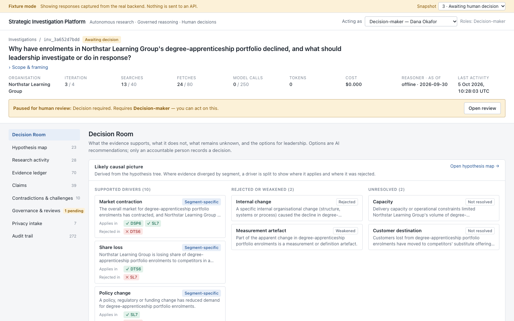
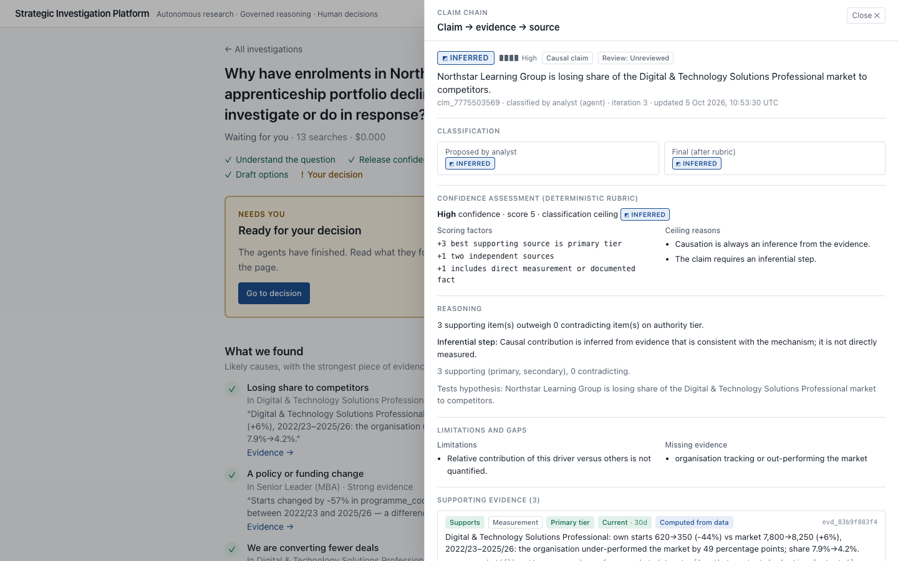
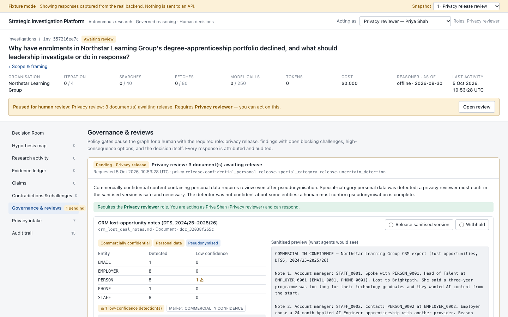
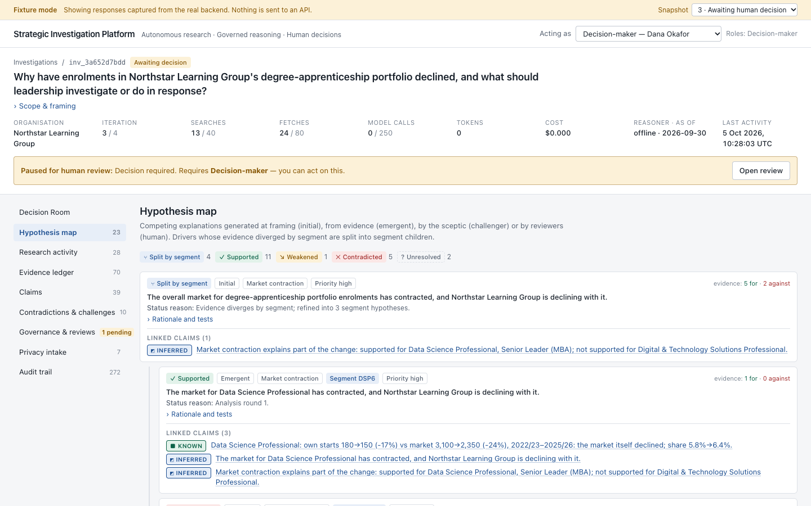
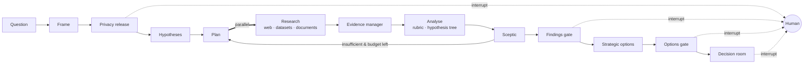

# Strategic Investigation Platform

**Autonomous research. Governed reasoning. Human decisions.**

> *"Why have enrolments in our degree-apprenticeship portfolio declined, and what should we do about it?"*

Questions like this reach leadership teams every quarter. The honest answer is never one cause. It is part
market, part competitor, part our own offer, part policy, part sales execution. Some of it can be measured,
some can only be inferred, and some cannot be known from the evidence available. Today that analysis takes
an analyst weeks, or it gets replaced by the most senior person's theory.

A chatbot or a RAG demo makes this worse in a specific way. It returns fluent, confident prose that blends
evidence, inference and guesswork. It cites sources that may not say what it claims. It keeps no record of
what was considered and rejected. And it quietly turns into "the AI recommends…", which in practice becomes
the decision.

This platform investigates the question the way a rigorous strategy team would:

1. It frames the question and generates **competing hypotheses**.
2. It plans research and runs it in parallel across the web, internal datasets (with real computation) and
   confidential documents. Those documents pass through a **privacy gateway** before any AI sees them.
3. It extracts evidence with **verbatim quotes and provenance**, and classifies every claim as
   **KNOWN / INFERRED / HYPOTHESIS / UNKNOWN** using a transparent rubric the model cannot override.
4. A **sceptic** attacks the emerging story: correlation versus causation, stale or weak sources, ignored
   contradictions, premature convergence. It can send the investigation back to research and commission
   disconfirming tests.
5. It produces **strategic options**: AI recommendations, never decisions, each traceable from option to
   finding to claim to evidence to source.
6. It is run by **one person directing the agents**. It stops at **governed checkpoints**: releasing sensitive material, approving high-consequence
   options, and the decision itself, which only that person can make. The interface is a short briefing:
   what was found, what was ruled out, what is still unknown, a few options, and the decision.



<table><tr>
<td width="33%"><br><sub>"Evidence →" opens the rubric, quotes and sources</sub></td>
<td width="33%"><br><sub>The agents ask before reading confidential documents</sub></td>
<td width="33%"><br><sub>Full working view: the hypothesis tree</sub></td>
</tr></table>

---

## What it found in the flagship scenario

*Northstar Learning Group* is a fictional training provider. Its starts fell 36% in three years. The
synthetic world plants several interacting causes, one coincidence that looks causal but isn't, misleading
internal and external sources, a prompt-injection page, and one question that cannot be answered from the
evidence. Offline run (`sip run`):

| | Conclusion | Classification |
|---|---|---|
| ✅ | Northstar is losing share of the **Digital & Technology Solutions** market (−44% vs a market up 6%) | INFERRED · high |
| ✅ | A Level 7 **funding change** explains the **Senior Leader** decline; it is *not supported* for DTS | INFERRED · high |
| ✅ | **Data Science** declined with its market | INFERRED · moderate |
| ✅ | Large-employer **conversion** on DTS collapsed (45% → 26%) | INFERRED · high |
| ✅ | Demand is shifting to **AI programmes** Northstar does not offer; offer is **dated** and **long** vs 24-month rivals | INFERRED · high |
| ❌ | The **North-region sales restructure** caused the decline. Rejected by a difference-in-change test the sceptic commissioned (−45% in the North vs −43% elsewhere) | Not supported |
| ⚠️ | Board paper: *"entirely due to the Level 7 funding changes"*. Flagged as a contradiction | — |
| ❓ | Where did the lost employers go: competitors' AI programmes, or out of apprenticeships? | **UNKNOWN**: needs employer destination data |

It reached this through three research rounds, three human interrupts (privacy release, options review,
decision) and a recorded human decision. Total spend was 13 searches and $0 in offline mode.

## Why not just chat or RAG?

| Need | Chat / RAG | This platform |
|---|---|---|
| Separate evidence from inference | Blended into prose | Every claim classified by a published rubric; causal claims capped at INFERRED |
| Know when we don't know | Fills gaps fluently | UNKNOWN is a first-class outcome, with the missing evidence named |
| Trust citations | Plausible links | Quotes verified verbatim against stored source text; numbers checked against evidence |
| Avoid confirmation bias | Answers the question as framed | Competing hypotheses, a sceptic, and disconfirming tests |
| Quantitative questions | LLM arithmetic over chunks | Deterministic analytics over role-typed datasets |
| Confidential data | Sent raw to the model | Pseudonymised and governed before the agent boundary |
| Accountability | "The AI said…" | Recommendation ≠ Decision; human-only decisions with an audit trail |

## How it works



* **LangGraph** orchestrates a typed, checkpointed state graph. Research fans out with `Send`, the
  challenger loops back to planning, and every human checkpoint is a durable `interrupt()`.
  [Architecture →](docs/architecture.md)
* **The model proposes; deterministic rules dispose.** LLMs frame, hypothesise, plan, extract and argue.
  Code does the arithmetic, verifies quotes, computes confidence, caps classification, enforces the budget
  and applies policy. [ADR 0002 →](docs/decisions/0002-model-proposes-rules-dispose.md)
* **Evidence model.** Source → Evidence (quote, tier, freshness, verification) → Claim (classification,
  rubric factors) → Finding (promotion criteria) → Recommendation → Decision (human-only). Source authority
  depends on *what the evidence is for*, and freshness is judged against the investigation's as-of date.
* **Privacy.** Validate, quarantine raw, detect PII and special-category data, classify confidentiality
  and personal data separately, pseudonymise with linkage preserved (`EMPLOYER_0004` stays `EMPLOYER_0004`)
  using a separate encrypted vault, then release under policy with human review.
  [Privacy →](docs/privacy.md)
* **Governance.** A YAML policy pack evaluated per activity, failing closed, with RBAC roles and every
  evaluation audited. [Governance →](docs/governance.md)
* **Domain-agnostic.** The core knows about dataset *roles*, a generic driver taxonomy and analytical
  *pattern codes*, not about apprenticeships. A test fails the build if domain vocabulary leaks into core
  packages. A second scenario (coffee subscriptions) runs through identical code.

## Evaluation

Evaluation checks whether the investigation found the **planted structure**, not whether its prose sounds
intelligent. Each scenario has machine-readable hidden ground truth that the application is forbidden to
read. Twelve deterministic graders run against it: hypothesis recall, false causal attribution, unknown
detection, contradiction detection, citation correctness (quotes re-verified against stored sources),
citation completeness, numeric grounding, source quality, injection resistance, governance compliance,
privacy leakage (every planted raw identifier searched across all agent-visible state and model inputs),
and research efficiency. Strategic usefulness is scored by a human using a rubric.

| Scenario | Reasoner | Automated graders |
|---|---|---|
| Northstar (apprenticeships) | offline | **12 / 12** |
| Harbourline (coffee subscriptions) | offline | **12 / 12** |
| either | LLM | not yet measured (see Status) |

Harbourline was written after Northstar passed and was run blind. It scored **10/12** and exposed a real
privacy bug: an unpseudonymised customer name in a reviewer preview, caused by overlapping regex matches.
Both defects were fixed generically. [Evaluation →](docs/evaluation.md)

## Run it locally

Requirements: Python 3.12+, Node 22+. No credentials are needed for the offline demo.

```bash
git clone <repo> && cd strategic-investigation-platform
cp .env.example .env                       # defaults: offline reasoner, offline corpus, SQLite
python -m venv .venv && source .venv/bin/activate
pip install -e '.[dev]'

sip run --scenario northstar               # whole investigation in the terminal (~1s)
sip eval run                               # evaluate both scenarios against hidden ground truth
pytest                                     # 91 backend tests

sip db upgrade && sip serve                # API on http://localhost:8000 (OpenAPI at /docs)
cd apps/web && npm ci && npm run dev       # briefing UI on http://localhost:3000 (npm test: 31 tests)
```

The web app also has a **fixture mode** (`NEXT_PUBLIC_USE_FIXTURES=true`) that runs without the backend.
See [apps/web/README.md](apps/web/README.md).

**With PostgreSQL (Docker Compose):** `docker compose up --build` starts Postgres (separate `sip` and
`sip_vault` databases), the API (runs migrations on start) and the web app.

**With a real model:** set `SIP_REASONER=llm`, `AZURE_OPENAI_BASE_URL`, and deployment names. Entra ID
via `DefaultAzureCredential` is the default; set `AZURE_OPENAI_AUTH=api_key` for local key auth.
**With live web research:** set `SIP_SEARCH_PROVIDER=tavily` (or `brave`) and the API key.
**With tracing:** set `LANGSMITH_TRACING=true` and `LANGSMITH_API_KEY`. `SIP_TRACE_CONTENT` controls what
content leaves the process.

## Repository map

```
src/sip/            domain · governance · evidence · privacy · research · tools · models · agents
                    graph · persistence · services · api · observability
apps/web/           Next.js briefing UI (+ full working view)
evals/              hidden ground truth, graders, runner, LangSmith experiments
data/synthetic/     fictional scenario packs (datasets, internal documents, offline web corpus)
migrations/         Alembic
infra/azure/        Bicep reference deployment       infra/local/  Compose init
docs/               architecture, governance, privacy, threat model, responsible AI,
                    evaluation, Azure deployment, ADRs, implementation plan
```

## Azure reference deployment

Bicep in [`infra/azure`](infra/azure) provisions Azure OpenAI, Azure AI Language, Container Apps,
PostgreSQL Flexible Server, a private Blob quarantine, Key Vault, a managed identity with least-privilege
role assignments, ACR, Log Analytics and Application Insights. Azure AI Search is optional. Each service
has a stated reason to exist. A manual GitHub OIDC workflow deploys it.
[Deployment guide →](docs/azure-deployment.md)

## Status: what is verified, and what isn't

**Verified locally:** the full offline investigation; the API end to end over HTTP (SQLite and
PostgreSQL 15, including Postgres checkpointing); Alembic migrations; RBAC and human-only decisions;
privacy gateway and vault; SSRF controls; evaluation (both scenarios 12/12); 91 backend and 31 frontend tests, including the LLM path end to end with a scripted imperfect model; ruff, mypy and
pip-audit clean; Bicep compiles and lints with zero warnings.

**Verified only with mocks (no credentials were available while building V1):** Azure OpenAI provider
(Responses and Chat Completions), the LLM reasoner end to end, Tavily/Brave, Azure AI Language PII, Blob
quarantine, Entra ID token validation, LangSmith experiment upload.

**Not done:** Docker images were not built (Docker was unavailable on the build machine); nothing was
deployed to Azure; LLM-mode evaluation scores have not been measured.

## Limitations

* The **offline reasoner** is a deterministic baseline built on taxonomy signal phrases. It is not
  intelligent, and its text heuristics were developed alongside the two scenarios. The scenario-independent
  machinery (analytics, rubric, sceptic, tree splitting, governance, privacy) carries most of the result.
* The local **PII detector** is pattern- and lexicon-based. Use Azure AI Language and keep human release
  review for real data.
* **Stance** (does this quote support or contradict?) is model or heuristic judgement and is not
  independently verified.
* Confidence bands are **ordinal** and uncalibrated.
* Runs execute **in-process**: one API replica, no worker queue.
* The driver taxonomy covers "why did a volume change?". Questions such as "should we enter market X?" need
  additional branches.

## Roadmap

1. Measure LLM-mode scores on both scenarios; compare model deployments and prompt versions in LangSmith.
2. A third scenario written by someone other than the author.
3. A worker-based execution model (Container Apps jobs + queue) so the API can scale out.
4. Azure AI Search retriever for the sanitised corpus at scale.
5. Retention policies with cascade deletion and vault expiry.
6. Taxonomy branches for evaluative and investment questions.
7. Calibration study: compare confidence bands with outcomes on historical decisions.

## How this was built

This project was built with AI coding assistance, deliberately. Architecture decisions are recorded as
[ADRs](docs/decisions/), the [implementation plan](docs/implementation-plan.md) records the starting
assessment, and the tests and evaluation are designed to catch the mistakes a fast build makes. Some
already did: see Evaluation.

All organisations, people, publishers, statistics and policies in `data/` are fictional.
