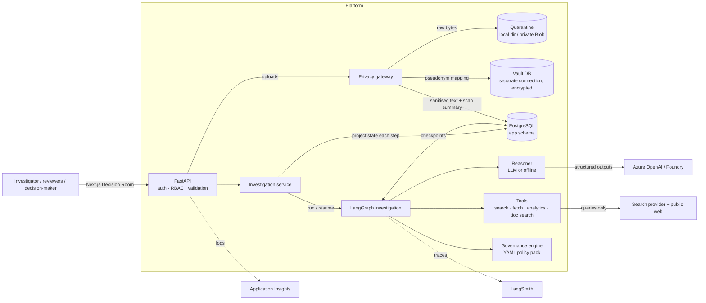
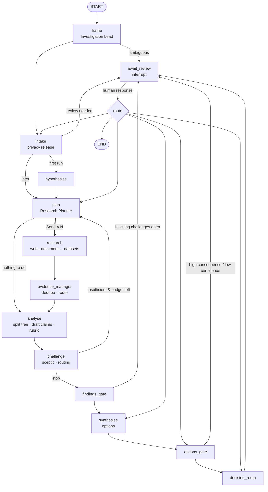

# Architecture

> **Autonomous research. Governed reasoning. Human decisions.**

This document describes the system as implemented. Where something is a reference design rather than
running code, it says so.

## 1. System context

The privacy boundary is the dashed line nobody crosses: everything to the right of the gateway
(graph, reasoner, tools, model provider, LangSmith) only ever sees **sanitised** content.

## 2. Code map

| Package | Responsibility | Depends on |
|---|---|---|
| `sip.domain` | Pydantic entities: Source, Evidence, Claim, Finding, Hypothesis, ResearchTask, StrategicOption (recommendation), Decision (human-only), HumanReview, AuditEvent, Challenge, Contradiction | nothing |
| `sip.governance` | Policy pack (`policies/default.yaml`) and engine | domain |
| `sip.evidence` | Source-quality policy, confidence rubric, evidence ledger (split/route/contradictions), deterministic sceptic | domain, tools |
| `sip.privacy` | Extraction, detectors (local, Azure AI Language), sensitivity classification, pseudonymisation, vault, quarantine, gateway | domain |
| `sip.research` | Search providers (offline corpus, Tavily, Brave), SSRF-safe fetcher, HTML extraction, injection screening, quote verification | domain |
| `sip.tools` | Dataset catalogue (role manifests) and deterministic analytical operations | domain |
| `sip.models` | `StructuredModel` protocol, Azure OpenAI provider, recording and scripted test doubles | — |
| `sip.agents` | `Reasoner` contract, LLM reasoner + versioned prompts, offline reasoner, generic driver taxonomy | models, domain |
| `sip.graph` | Typed state, runtime context, nodes, topology, checkpointer | everything above except privacy internals and persistence |
| `sip.persistence` | SQLAlchemy tables, repository/projection | domain |
| `sip.services` | Investigation service (run/resume/project), bootstrap, scripted runner, terminal demo | graph, persistence, privacy |
| `sip.api` | FastAPI app, auth, schemas, routes | services |
| `evals/` | Ground truth, graders, runner, LangSmith experiments (outside the package on purpose) | sip |

Two boundaries are enforced by tests (`tests/unit/test_architecture_boundaries.py`), not just by
convention: agent-side packages cannot import the vault, quarantine, detectors or gateway; and agent
code cannot import persistence or vendor SDKs. A third test fails the build if apprenticeship (or
coffee) vocabulary appears in core packages.

## 3. The investigation graph

### Node responsibilities

| Node | Does | Does not |
|---|---|---|
| `frame` | Interprets question; scope, objectives, assumptions, ambiguities; asks for clarification via policy | Attempt an answer |
| `intake` | Evaluates `release_document_to_agents` / `analyse_internal_dataset` policy per sanitised item; releases, withholds or requests privacy review | See raw content (it only has sanitised `IntakeDocument`s) |
| `hypothesise` | Competing hypotheses, each in a taxonomy category | Converge |
| `plan` | Tasks from open hypotheses, challenger questions and human requests; validates operations; detects unavailable evidence; dedupes; applies budget caps | Run research |
| `research` (×N) | One task: search→fetch→screen→extract→verify quotes→assess quality; or BM25 over released docs; or a deterministic analysis | Write to shared collections directly (output is staged) |
| `evidence_manager` | Deduplicates sources (URL/hash) and evidence (normalised quote); routes links into the hypothesis tree | — |
| `analyse` | Splits hypotheses where evidence diverges by segment; drafts claims per hypothesis; applies the confidence rubric; updates hypothesis status; detects contradictions | Decide classification on the model's say-so |
| `challenge` | Deterministic sceptic + optional LLM challenger; merges challenge lifecycle; decides whether to loop | Rewrite the analysis |
| `findings_gate` | Promotes claims meeting finding criteria; marks untested hypotheses unresolved; requests review if research stopped with blocking challenges | — |
| `synthesise` | Strategic options from causal findings, unknowns and caveats | Create decisions |
| `options_gate` | `present_recommendation` policy; requests review for high-consequence / low-confidence options | — |
| `decision_room` | Prepares the decision review (approved options, unknowns to acknowledge) | Decide |
| `await_review` | The only `interrupt()`; validates actor kind, role and action; applies overrides, challenges, research requests, decisions | Accept agent or wrong-role responses |

**Why gate nodes are separate from `await_review`.** LangGraph re-executes an interrupted node from
the top when it resumes. A node that wrote a pending review and then called `interrupt()` would lose
the write. Gates write the review; `await_review` interrupts.

### State

`InvestigationState` (`sip/graph/state.py`) is a `TypedDict` of typed channels. Entity collections are
`dict[id, Model]` with a merge reducer, so parallel research branches cannot overwrite one another.
Audit events and routing decisions are append-only; usage is summed. Research branches write to a
`staging` channel that the evidence manager deduplicates and then resets.

### Runtime dependencies

Nodes receive dependencies through LangGraph's `context_schema` (`InvestigationContext`): reasoner,
search provider, fetcher, dataset catalogue, intake reader (sanitised only), governance engine,
source-quality policy, taxonomy. Nothing constructs its own clients.

### Bounding the loop

`decide_routing` (`graph/nodes/analysis.py`) stops research when any of these hold, in order:
budget exhausted (searches, fetches, model calls, cost); `iteration >= max_iterations`; no actionable
challenge, no unplanned hypothesis and no human request (`sufficient_evidence`); or the last round
produced no new evidence (`diminishing_returns`). Each decision is persisted with its rationale. The
planner also caps tasks per round (16) and in total, and merges duplicate task proposals. LangGraph's
recursion limit (250) is a final backstop. Humans can extend the iteration budget by at most 3 per
review.

## 4. The model proposes; deterministic rules dispose

| Step | Model (LLM mode) | Deterministic control |
|---|---|---|
| Frame / hypothesise / plan | Drafts | Category must be in taxonomy; operations validated against catalogue; budget, dedupe, unavailable-data detection |
| Extract | Quotes + stance | Quote must be found verbatim in the passage; passages that look like instructions are flagged and excluded; source quality assessed from source type and date |
| Quantitative analysis | Chooses operation and parameters | All arithmetic in `sip.tools.analytics`; patterns mapped to stances by the taxonomy |
| Claims | Proposes classification | Confidence rubric computes band and caps classification (`sip.evidence.confidence`) |
| Challenge | Semantic challenges | Deterministic sceptic always runs (`sip.evidence.sceptic`) |
| Options | Drafts | Must cite existing findings; confidence = weakest cited finding |
| Release, presentation, decision | — | Governance engine; HITL; `Decision` validator |

## 5. Two reasoners

`LLMReasoner` (Azure OpenAI structured outputs, prompts in `sip/agents/prompts/*.md`) and
`OfflineReasoner` (deterministic heuristics over the generic driver taxonomy) implement the same
`Reasoner` protocol. The offline reasoner exists so the platform runs end-to-end in CI and for anyone
without credentials, and so evaluation has a reproducible floor. Most of what makes the Northstar result
correct is *shared* deterministic machinery (analytics, rubric, sceptic, tree splitting), which is the
point: those parts should not depend on a model behaving well. See ADR 0002.

## 6. Generic by construction

The core knows about *roles* (own volume, market volume, funnel, customer destination), *driver
categories* (market contraction, share loss, offer format, substitution, policy change, conversion, …)
and *pattern codes* (`own_underperforms_market`, `no_group_difference`, …). Scenario packs supply the
data and names. The second scenario (coffee subscriptions) runs through identical code.

## 7. Persistence and execution

* PostgreSQL holds investigations and one table per entity type (relational keys + validated JSON
  payload), audit events (append-only), and sanitised intake records. Alembic manages the schema.
* LangGraph checkpoints use `AsyncPostgresSaver` (SQLite saver locally, in-memory in tests) with an
  explicit deserialisation allowlist of our own types.
* The service projects graph state into tables after every step, so the UI and audit queries never
  read checkpoints.
* Runs execute as in-process background tasks with a per-investigation lock. Multi-replica deployment
  would move execution to a worker; checkpoints already make runs resumable (see roadmap).

## 8. Observability

* **LangSmith**: LangGraph runs, node spans (with `agent` metadata), model calls (via
  `langsmith.wrappers.wrap_openai`, including token usage), research tasks (`research_task_id`,
  `method`, `hypothesis_ids` metadata), investigation-level metadata (`investigation_id`, `scenario`,
  `reasoner`, `environment`, model deployments). Content policy via `SIP_TRACE_CONTENT`.
* **Application logs**: structlog JSON with `investigation_id` bound per run; exported to Application
  Insights when the `azure` extra is installed and a connection string is configured. Logs carry IDs,
  counts and classifications only.
* **Usage/cost**: per-investigation `Usage` (searches, fetches, analyses, model calls, tokens, cost from
  configured prices) is stored in state, shown in the UI header and enforced by the budget.

## 9. Where to look next

[governance.md](governance.md) · [privacy.md](privacy.md) · [evaluation.md](evaluation.md) ·
[threat-model.md](threat-model.md) · [responsible-ai.md](responsible-ai.md) ·
[azure-deployment.md](azure-deployment.md) · [decisions/](decisions/)
