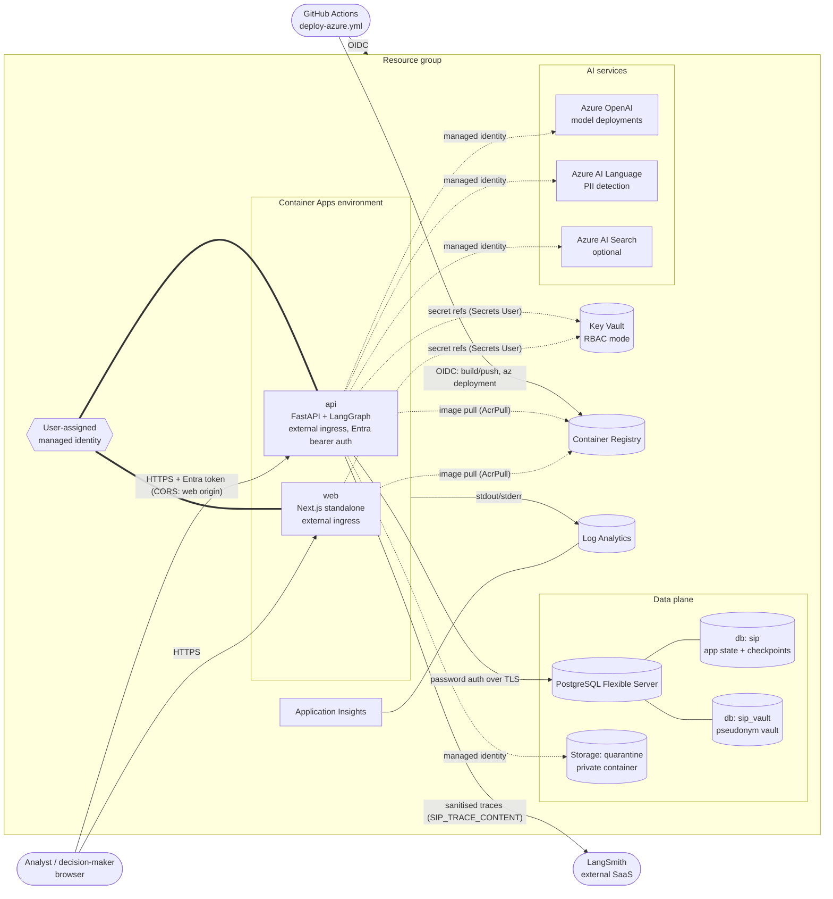

# Azure deployment

This document describes the Azure reference deployment in [`infra/azure/`](../infra/azure/README.md): what
each service is for (and not for), how identity and secrets work, the network posture and its trade-offs,
where the privacy boundary sits in Azure, observability, cost, how to deploy, and — plainly — what has and
has not been validated.

Local development does not need any of this: `docker compose up --build` runs Postgres + API + web with the
offline reasoner and offline search corpus, no credentials required.

---

## 1. Architecture

Deployment is two-phase (the same template both times): `deployApps=false` creates the platform including
ACR; images are built and pushed; a second run with `apiImage`/`webImage` creates or updates the apps.

## 2. Services: why each is used, and what it is not used for

| Service | Used for | Not used for |
|---|---|---|
| **Azure Container Apps** (environment + `api` + `web`) | Running the two containers with managed ingress/TLS, revisions, health probes, scale-to-zero for `web`, native managed-identity integration for ACR and Key Vault | Long-running batch/eval jobs (run in CI); hosting the database |
| **Container Registry** | Private storage of the `sip-api` / `sip-web` images, pulled with the managed identity (`AcrPull`); admin user disabled | Public image distribution |
| **User-assigned managed identity** | The single workload principal: ACR pull, Key Vault reads, Azure OpenAI, Language, Blob, (Search). Pre-created so roles exist before the apps start | Human access; CI deployment (that uses a separate GitHub OIDC identity) |
| **Key Vault** (RBAC mode) | Secrets: `sip-vault-key`, `database-url`, `vault-database-url`, `appinsights-connection-string`, optional `tavily-api-key` / `brave-api-key` / `langsmith-api-key` | Azure service credentials (managed identity replaces them); configuration that is not secret |
| **PostgreSQL Flexible Server** | `sip` (investigations, evidence, audit projection, LangGraph checkpoints, Alembic-managed) and `sip_vault` (pseudonym vault, separate connection) | Raw uploads (Blob quarantine); analytics/warehousing |
| **Storage account** (`quarantine` container) | Raw, un-sanitised upload bytes, private, shared-key disabled, lifecycle-expired after `quarantineRetentionDays` | The sanitised corpus, app state, static web assets, backups |
| **Azure OpenAI** | LLM reasoner (`SIP_REASONER=llm`) via the OpenAI-compatible v1 endpoint, structured outputs, Entra auth, `store=false` | Embeddings/vector search (not in V1); PII detection; any step that sees raw content |
| **Azure AI Language** | PII entity recognition inside the privacy gateway (`SIP_PII_DETECTOR=azure_language`, parameter `piiDetector`; keyless Entra auth; template default `local` until verified live — §9), alongside local detectors | Anything after sanitisation; sentiment/summarisation |
| **Azure AI Search** (optional, `deploySearch`) | Scale-out retrieval path: persistent, shared, hybrid index | Default operation — the app uses an in-process BM25 index over the sanitised corpus |
| **Log Analytics** | Container console/system logs incl. the API's structured JSON logs (investigation IDs bound) | Agent/LLM trace trees (LangSmith) |
| **Application Insights** | Workspace-based APM resource; connection string delivered to the API via Key Vault | LLM-level tracing (LangSmith) |

**Why Azure AI Search is optional.** At demo scale (one scenario, hundreds of passages) the in-process BM25
index is fast, deterministic, free, and keeps retrieval entirely inside the process that already holds the
sanitised corpus — no extra copy of evidence in another service. Search becomes worthwhile with many
concurrent investigations, a large persistent corpus or hybrid/vector retrieval. A Basic service bills
continuously, so it is behind `deploySearch=false`. The application currently has `AZURE_SEARCH_*` settings
but no Search-backed retriever; enabling it provisions the service and roles only.

## 3. Identity and secrets model

- **Managed identity everywhere a service supports Entra auth.** Azure OpenAI, AI Language and AI Search are
  deployed with `disableLocalAuth: true`; the Storage account with `allowSharedKeyAccess: false`; ACR with the
  admin user disabled. There are no keys to leak because none exist. The API selects the user-assigned
  identity through `AZURE_CLIENT_ID` (honoured by `DefaultAzureCredential`).
- **Role assignments are resource-scoped**, never resource-group-wide: Cognitive Services OpenAI User,
  Cognitive Services User (Language), Storage Blob Data Contributor, Key Vault Secrets User, AcrPull, and —
  only when Search is deployed — Search Index Data Contributor + Search Service Contributor.
- **Secrets live only in Key Vault.** The template writes them from `@secure()` parameters (never echoed in
  deployment outputs or history). Container Apps reference them by versionless Key Vault URL and resolve them
  with the managed identity, so app configuration contains secret *names*, not values. Rotating a secret in
  Key Vault is picked up on the next revision/restart.
- **`SIP_VAULT_KEY` must be stable.** It encrypts and keys the pseudonym vault; changing it orphans existing
  vault rows. Key Vault purge protection is on by default to prevent accidental permanent deletion.
- **Database credentials are the one password-based link.** Postgres has Entra authentication enabled (for
  human admins via `postgresEntraAdmin`), but the application connects with the administrator password
  embedded in the Key Vault connection-string secrets, because the app does not yet fetch Entra access
  tokens for Postgres. Both databases currently use the same admin login; production should create a
  dedicated least-privilege role per database (the local Compose stack already does this for the vault).
- **CI/CD uses GitHub OIDC** (workload identity federation). No Azure credential is stored in GitHub; the
  federated identity needs Contributor + Role Based Access Control Administrator on the resource group.
- **User authentication.** The API runs with `SIP_ENV=production`, which refuses dev header auth;
  `SIP_AUTH_MODE=entra_id` validates bearer tokens for `entraApiAudience` from `entraTenantId`.

## 4. Network posture and trade-offs

The reference deployment uses **public endpoints with identity, TLS and firewalls**, not private networking.
This keeps it deployable in minutes on a Consumption environment and cheap enough for a portfolio, at the
cost of a larger attack surface than a production system should accept.

| Component | Posture here | Production hardening |
|---|---|---|
| `web` | External ingress, HTTPS only | Front Door/WAF, custom domain |
| `api` | External ingress, HTTPS only, Entra bearer tokens required, CORS restricted to the web origin by the app (`SIP_CORS_ORIGINS`) | Internal ingress with the web tier proxying API calls server-side; or Front Door + WAF + IP restrictions |
| PostgreSQL | Public access; firewall `AllowAzureServices` (0.0.0.0) + optional operator IP; TLS required (`sslmode=require`) | **Private access**: VNet-integrated Container Apps environment + delegated subnet + private DNS zone. Note 0.0.0.0 admits *any* Azure tenant's traffic to attempt a login |
| Storage | Public endpoint, Entra-only auth, no anonymous access | Private endpoint + `defaultAction: Deny` (Consumption Container Apps have no stable egress IP and are not a trusted service, so this requires VNet integration) |
| Key Vault, ACR, OpenAI, Language, Search | Public endpoints, Entra-only data access | Private endpoints; ACR Premium for private link |

Why the API is external rather than internal: the web UI is a client-rendered Next.js app that calls the
API from the browser at `NEXT_PUBLIC_API_BASE_URL` (a build-time value). An internal-only API would need
the Next.js server to proxy every call; that is the recommended next step, after which the API ingress can
be switched to `externalIngress: false`.

## 5. Privacy boundary in Azure

The application's privacy model (see `docs/privacy.md` and `src/sip/privacy/`) maps onto Azure as follows.
**Raw or reversible data exists in exactly two places**:

1. **Raw quarantine** — raw upload bytes. Target: the private `quarantine` Blob container (Entra-only,
   lifecycle deletion). The API receives `SIP_QUARANTINE_BLOB_URL` and writes raw bytes there with its
   managed identity (`BlobQuarantine`, Blob REST API + `Storage Blob Data Contributor`). Locally, raw bytes
   go to `var/quarantine` instead. (`apiMaxReplicas` stays 1 for a different reason: investigation runs
   execute in-process; see the architecture roadmap.)
2. **Pseudonym vault** — the reversible pseudonym ↔ value mapping, encrypted with `SIP_VAULT_KEY` (Key
   Vault) and stored in the separate `sip_vault` database via its own connection string.

Everything else — the `sip` database, LangGraph checkpoints, Azure OpenAI prompts, LangSmith traces, logs —
receives only sanitised (pseudonymised) content. Azure AI Language is the one external service that sees
pre-sanitisation text, because detecting PII is its job; it is called from inside the gateway with the
managed identity and does not persist request content. Azure OpenAI is called with `store=false`.

## 6. Observability

- **Logs:** the API writes structured JSON (`SIP_LOG_JSON=true`) to stdout; Container Apps ships it to
  Log Analytics (`ContainerAppConsoleLogs_CL`). Query by investigation ID.
- **Application Insights:** provisioned (workspace-based) and its connection string is delivered as
  `APPLICATIONINSIGHTS_CONNECTION_STRING` from Key Vault. The API image installs the `azure` extra
  (`azure-monitor-opentelemetry`) and calls `configure_azure_monitor` at startup when the connection string
  is present, exporting requests, dependencies and the structured logs (which never contain content).
- **LangSmith:** graph, node, LLM and tool traces when `langsmithTracing=true` and a `langsmithApiKey` is
  supplied. `SIP_TRACE_CONTENT` (parameter `traceContent`) controls what leaves the process:
  `full` (sanitised content as-is), `redacted` (additional email/phone/national-ID scrubbing), or
  `metadata_only` (structure, timings, token usage; no inputs/outputs). The Azure template defaults to
  **`metadata_only`**, the conservative choice for a deployed environment; the application default is
  `redacted`. LangSmith is an external SaaS — choose its data region and retention accordingly.

## 7. Cost notes (indicative, pay-as-you-go, not a quote)

| Item | Default | Cost driver |
|---|---|---|
| Container Apps (Consumption) | api 1 vCPU / 2 GiB, min 1 replica; web 0.5 vCPU, scales to 0 | The always-on API replica is the main fixed compute cost; set `minReplicas: 0` for a cold-start-tolerant demo |
| PostgreSQL Flexible Server | Burstable B1ms, 32 GB | Small fixed monthly cost; stop the server when idle (it auto-restarts after 7 days) |
| Azure OpenAI | GlobalStandard deployments | Pay per token; a full LLM investigation is bounded by the app's research budget (`SIP_BUDGET_MAX_COST_USD`, default $5) |
| AI Language | S tier | Per text record; only uploads/scenario documents are scanned |
| ACR Basic, Key Vault, Storage | — | Low |
| Log Analytics / App Insights | 30-day retention | Ingestion volume; JSON logs are compact |
| AI Search | **off** | Basic tier bills continuously — the main reason it is optional |

Tear down with `az group delete -n <rg>`. Key Vault purge protection keeps the vault name reserved for
the soft-delete period (90 days); use a different `environmentName` to redeploy sooner.

## 8. Deploy

### Prerequisites

1. Azure subscription with Azure OpenAI quota for the chosen models in `aiLocation` (check the
   [model availability table](https://learn.microsoft.com/azure/foundry/foundry-models/concepts/models-sold-directly-by-azure);
   the defaults are `gpt-5.1` `2025-11-13` and `gpt-5-mini` `2025-08-07`, GlobalStandard).
2. A resource group.
3. An Entra **app registration for the API** — expose an API with an App ID URI (this is
   `entraApiAudience`), and configure the web client to request tokens for it.
4. A **deployment identity** for GitHub OIDC: an app registration or user-assigned identity with a federated
   credential for `repo:<owner>/<repo>:environment:<env>`, granted **Contributor** and **Role Based Access
   Control Administrator** on the resource group.
5. Secret values generated once and stored as GitHub environment secrets:
   `SIP_VAULT_KEY` (`openssl rand -base64 48`) and `POSTGRES_ADMIN_PASSWORD`.

### Via GitHub Actions (recommended)

1. Create a GitHub environment (e.g. `dev`) with:
   - **variables:** `AZURE_CLIENT_ID`, `AZURE_TENANT_ID`, `AZURE_SUBSCRIPTION_ID`, `AZURE_RESOURCE_GROUP`,
     `ENTRA_API_AUDIENCE`
   - **secrets:** `SIP_VAULT_KEY`, `POSTGRES_ADMIN_PASSWORD`; optionally `TAVILY_API_KEY`, `BRAVE_API_KEY`,
     `LANGSMITH_API_KEY`
2. Review `infra/azure/main.parameters.json` (region, models, reasoner, search provider, trace mode).
3. Actions → **Deploy to Azure** → *Run workflow* → choose the environment.
   The workflow: OIDC login → phase 1 (platform) → build and push both images to ACR (tagged with the commit
   SHA; the web image is built with the API URL) → phase 2 (container apps) → polls `GET /health`.

The workflow is `workflow_dispatch` only; pull-request CI (`ci.yml`) never touches Azure and needs no secrets.

### Manually (Azure CLI)

See [`infra/azure/README.md`](../infra/azure/README.md#deploy-manual) — the same two phases using
`az deployment group create` and `az acr build`.

### After deploying

- Open the `webUrl` output. Sign-in depends on the web client's Entra configuration.
- `SIP_REASONER=llm` is the Azure default; set `reasoner=offline` for a credential-free smoke test of the
  infrastructure itself.
- If you choose `searchProvider=tavily|brave`, supply the matching API key or the API refuses to start
  research.
- First deployments can fail transiently while new role assignments propagate (ACR pull / Key Vault
  reference errors). Re-running the workflow is safe; the template is idempotent.

## 9. What has and has not been validated

Validated by the author's tooling (no Azure subscription was used):

- `bicep build infra/azure/main.bicep` (Bicep CLI 0.47.16) — **compiles with 0 errors and 0 warnings**, with
  the `use-recent-api-versions`, `outputs-should-not-contain-secrets` and `secure-secrets-in-params` linter
  rules enabled. This checks resource types, API versions and property names against the Bicep type
  definitions; it does not check regional availability, quota or policy.
- Role definition GUIDs were checked against the Microsoft Learn built-in roles reference; model names and
  versions against the Foundry models reference (September 2026).
- GitHub workflows pass `actionlint`; Dockerfiles pass `hadolint`.
- The API container's runtime contract was exercised **without Docker**: the build context (per
  `.dockerignore`) was copied to a scratch directory with the same `/app` layout, installed, and the
  entrypoint ran `sip db upgrade` against SQLite and against a local PostgreSQL (including the Compose init
  script creating `sip_vault` with its own role), then `sip serve` answered `GET /health` with 200 and the
  image's `HEALTHCHECK` command succeeded.

**Not** validated:

- **Never deployed to Azure.** No `what-if`, no deployment, no runtime test of Key Vault references, managed
  identity token flows, Container Apps probes, or the GitHub OIDC workflow.
- **Docker images were never built** (Docker was not available); the Compose stack was not started.
- The web image could not be build-checked: the Next.js app was still under construction at the time.
- Entra user authentication end-to-end (web → API) is untested.
- Keyless Azure AI Language is wired (Entra token provider via `DefaultAzureCredential`) and covered by a
  mocked test, but not exercised against a live resource; the template still defaults to `piiDetector=local`
  — set `azure_language` once verified in your subscription.
- The Blob quarantine adapter and the Application Insights exporter are implemented but only tested with
  mocks / not exercised against live Azure.
