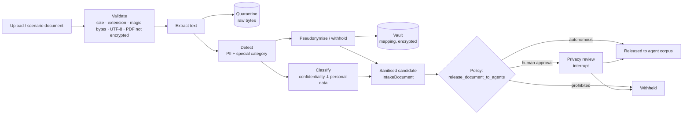

# Privacy architecture

**Principle:** sensitive data is sanitised *before* it reaches the agent boundary. The platform never
sends raw confidential content to the investigation model and then asks the model to redact it.

## Pipeline

Code: `sip/privacy/{extraction,detectors,azure_language,sensitivity,vault,quarantine,gateway}.py`;
release is `graph/nodes/framing.py::intake`.

## What each stage does

**Secure ingestion** (`extraction.py`): extension allowlist (`.txt .md .csv .json .pdf`), content
sniffing (a `.pdf` must start with `%PDF-`; PDF bytes under another extension are rejected), UTF-8
required, encrypted PDFs rejected, page cap, filename stripped of paths/control characters, size limit
enforced before reading the whole body.

**Detection** (`detectors.py`): the local detector finds emails, UK phone numbers, postcodes, National
Insurance numbers, organisations (legal-suffix patterns), names introduced by role cues
("Account manager:", "Customer", "Spoke with" …), honorific names and given-name pairs (Unicode-aware).
Names the detector is unsure of (unfamiliar given name after a cue) are reported with confidence 0.6,
which **forces human review** by policy. Special-category data (health, religion, ethnicity, sexual
orientation, criminal) is detected at sentence level. With `SIP_PII_DETECTOR=azure_language`, Azure AI
Language PII recognition replaces person/organisation/contact detection; special-category screening
still runs locally.

**Classification** (`sensitivity.py`): two independent axes.

| Confidentiality | Personal data |
|---|---|
| public · internal · commercially_confidential · restricted | none · personal · special_category |

Confidentiality is the maximum of what the uploader declared, document markings ("COMMERCIAL IN
CONFIDENCE", "BOARD PAPER", "STRICTLY CONFIDENTIAL") and commercial cues (margins, pricing strategy).
Removing personal data does not lower confidentiality.

**Pseudonymisation** (`gateway.py`, `vault.py`): every detected entity is replaced with a stable typed
token: `PERSON_0001`, `STAFF_0003`, `EMPLOYER_0002`, `EMAIL_0001`. The same value always maps to the same
token, so analysis can see that "EMPLOYER_0004 chose a 24-month programme" and "EMPLOYER_0004 cited
duration" are the same employer. Special-category sentences are **withheld** entirely
(`[WITHHELD:HEALTH]`), not pseudonymised. Public names (the organisation itself, named competitors) are
allowlisted per scenario.

**The vault** is a separate security boundary:

* separate database connection (`VAULT_DATABASE_URL`; a separate database and, in Compose, a separate
  role);
* lookups by keyed HMAC of the normalised value; real values encrypted (Fernet) with a key derived from
  `SIP_VAULT_KEY` (Key Vault in Azure; required in production);
* no API exposes re-identification in V1;
* `tests/unit/test_architecture_boundaries.py` fails if any graph/agent/research/tool/evidence module
  imports the vault, quarantine, detectors or gateway.

**Quarantine**: raw bytes stored with `0600` permissions locally, or in a private Blob container via
managed identity (`SIP_QUARANTINE_BLOB_URL`) in Azure. Nothing reads quarantine back in V1; it exists for
audit and for re-processing with an improved detector.

## What crosses the boundary

| Crosses | Never crosses |
|---|---|
| Sanitised text, scan **counts** by entity type, classification, markers, pseudonyms | Raw text, detected values, vault mappings, raw file bytes |

Reviewers see the same sanitised preview the agents would see, plus counts and the policy rule.

## Human free text

Reviewer notes, research requests, challenges and decision statements are passed through
`gateway.sanitise_text` by the API before entering graph state, because graph state reaches the model.
(`test_end_to_end_review_flow_with_rbac` asserts a typed name is pseudonymised.)

## Observability

LangSmith receives agent-side (already sanitised) content. `SIP_TRACE_CONTENT=redacted` (default) also
scrubs anything resembling an email, phone or NI number; `metadata_only` hides inputs/outputs entirely.
Application logs record IDs, counts and classifications only.

## Evaluation

The `privacy_leakage` grader searches the **entire serialised graph state** (and, in LLM mode, every
recorded model input) for every raw identifier planted in the scenario documents.

> The second scenario initially **failed** this grader: in "Customer Laura Bennett", the name-pair
> pattern consumed "Customer Laura" (rejected: not a given name) and never examined "Laura Bennett".
> The sanitised preview shown to the privacy reviewer contained the name. Fixed with an overlapping
> lookahead match; regression test `test_overlapping_name_candidates_regression`. This is the kind of
> defect the evaluation exists to catch.

## Limitations

* The local detector is pattern- and lexicon-based. It will miss names without cues that are not in the
  lexicon, and free-text identifiers (job titles that identify one person). Use Azure AI Language for
  real data, and keep humans in the release loop for confidential material (the default policy does).
* Pseudonymised data can still be re-identifiable in combination (small segments, unique events).
  Confidential + personal documents therefore require review by default.
* Structured datasets are scanned as text; the policy prohibits agent analysis of row-level personal
  data, so supply aggregates.
* Retention: no automated deletion in V1. See [responsible-ai.md](responsible-ai.md#data-retention).
